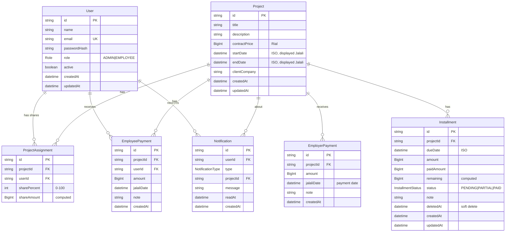
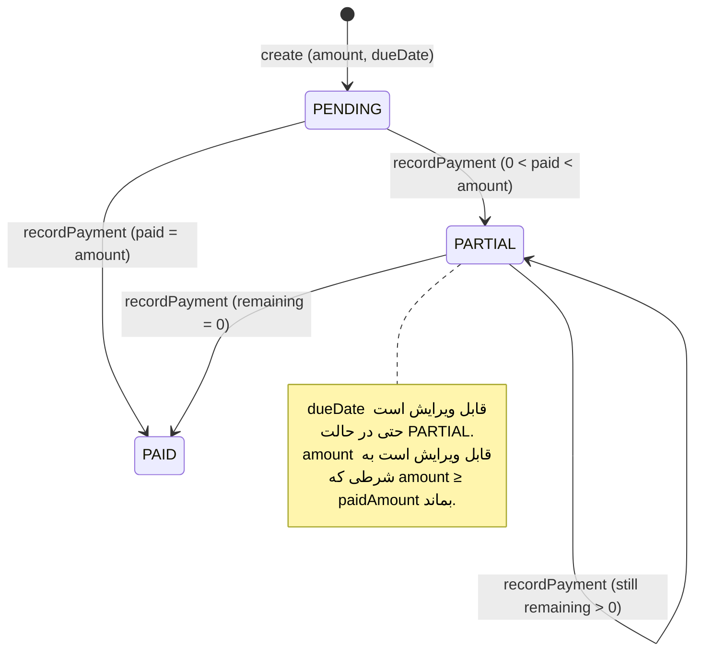

# ۰۰ — لایه دانش (Knowledge Layer)

سامانه مدیریت پروژه — Persian/Farsi UI، RTL، تقویم جلالی.
این سند منبع واحد حقیقت برای دامنه، قوانین کسب‌وکار، اعتبارسنجی، فرمول‌ها و قراردادهای فنی است.

---

## ۱. واژه‌نامه دامنه (Glossary FA/EN)

| واژه فارسی | English | تعریف |
|---|---|---|
| کاربر | User | هر فرد دارای حساب: مدیر یا کارمند |
| مدیر | ADMIN | نقشی با دسترسی کامل CRUD روی همه‌چیز |
| کارمند | EMPLOYEE | نقشی فقط‌خواندنی؛ فقط پروژه‌های خودش و سهم خودش را می‌بیند |
| پروژه | Project | قرارداد کاری با قیمت کل (ریال) و تاریخ شروع/پایان جلالی |
| کارفرما | Employer / Client | طرف قرارداد (پروژه) که مبالغ را پرداخت می‌کند |
| قیمت پیمان / مبلغ پروژه | contractPrice | مبلغ کل قرارداد به **ریال**، ذخیره‌سازی `BigInt` |
| سهم / درصد سهم | sharePercent / shareAmount | درصد صحیح ۰–۱۰۰ از مبلغ پروژه متعلق به یک کارمند؛ مبلغ سهم = قیمت × درصد / ۱۰۰ |
| تخصیص پروژه | ProjectAssignment | پیوند کارمند↔پروژه با درصد سهم |
| مانده حساب / بدهی کارفرما | outstanding debt | مبلغی که کارفرما هنوز باید بدهد = قیمت پیمان − مجموع پرداخت‌های کارفرما |
| پرداخت کارفرما | EmployerPayment | پول واقعی که کارفرما به حساب پروژه واریز کرده |
| قسط / چک | Installment | سطر زمان‌بندی بدهی کارفرما با سررسید جلالی، مبلغ، پرداخت‌شده، باقی‌مانده |
| پرداخت کارمند | EmployeePayment | پرداخت مدیر به کارمند از سهم او در پروژه |
| مانده سهم کارمند | employee remaining | مبلغ سهم − مجموع پرداخت‌های کارمند در آن پروژه |
| اعلان | Notification | پیام سیستمی برای کارمندان تخصیص‌یافته هنگام هر پرداخت کارفرما |
| ریال / تومان | Rial / Toman | مبالغ در DB به **ریال** (BigInt) ذخیره و در UI به **تومان** با جداکننده هزارگان نمایش داده می‌شوند |
| تاریخ جلالی | Jalali (Shamsi) | تقویم شمسی؛ نمایش `۱۴۰۳/۰۵/۰۱` |

---

## ۲. قوانین کسب‌وکار (Business Rules)

### BR-1 — نقش‌ها و دسترسی‌ها
- **ADMIN**: CRUD کامل روی پروژه‌ها، تخصیص‌ها، پرداخت‌های کارفرما، اقساط، پرداخت‌های کارمند و کاربران. درصد سهم هر کارمند را به‌صورت دستی در هر پروژه تعیین می‌کند.
- **EMPLOYEE** (فقط‌خواندنی):
  - فقط پروژه‌هایی که به آن‌ها تخصیص داده شده.
  - فقط **سهم خودش** (درصد + مبلغ به تومان) در هر پروژه؛ هرگز سهم/مبلغ/پرداخت سایر کارمندان.
  - کل پرداخت‌های کارفرما + اقساط + تاریخچه آن پروژه‌ها قابل مشاهده (بدون محدودیت).
  - فقط پرداخت‌های کارمندی خودش.

### BR-2 — جریان بدهی کارفرما
1. ایجاد پروژه با قیمت کل → این مبلغ وارد «مانده حساب / بدهی کارفرما» آن پروژه می‌شود.
2. **هر قسط به‌صورت جداگانه** اعتبارسنجی می‌شود: مبلغ یک قسط نباید از بدهی باقی‌مانده کارفرما (قیمت پیمان − مجموع پرداخت‌های کارفرما) بیشتر شود. اعتبارسنجی «مجموع اقساط» انجام **نمی‌شود** — بدهی باقی‌مانده با هر پرداخت کارفرما کوچک‌تر می‌شود و اگر جمع کل план بررسی می‌شد، اصلاح plan یک پروژه که قبلاً بر اساس مبلغ کامل قرارداد کشیده شده بود غیرممکن می‌گشت. در ازای آن، `DebtSummaryCard` طرح بیش از تخصیص‌یافته را با رنگ قرمز نشان می‌دهد (دفاع UI).
3. پیام خطای فارسی دقیق هنگام تخلف:
   - پرداخت کارفرما: **«مبلغ پرداختی بیشتر از بدهی باقی‌مانده کارفرما ({remaining} تومان) است.»**
   - ایجاد/ویرایش قسط: **«مجموع اقساط نمی‌تواند از بدهی باقی‌مانده کارفرما ({remaining} تومان) بیشتر باشد. برای افزایش این قسط، ابتدا از مبلغ یک قسط دیگر کم کنید.»**
4. پرداخت جزئی قسط، همزمان یک ردیف `EmployerPayment` هم می‌نویسد (پول واقعی دریافتی است)؛ این تنها نوشتن متقاطع جداول فاز ۳ است.

### BR-3 — اقساط
- ایجاد به دو صورت:
  - **تولید گروهی/مساوی**: مبلغ ثابت هر دوره + تعداد + فاصله ماهانه (مثلاً ۵۰ میلیون برای N ماه با شروع از تاریخ مشخص).
  - **ثبت دستی تک‌تک**: مبالغ و تاریخ‌های دلخواه.
- پرداخت جزئی مجاز است: ثبت پرداخت مبلغی کمتر از باقی‌مانده → `remaining = amount − paidAmount`، وضعیت `PARTIAL`.
- مدیر می‌تواند **سررسید** قسط را حتی پس از پرداخت جزئی ویرایش کند.
- هنگامی که `remaining = 0` → وضعیت `PAID`؛ قسط با نشانگر سبز در لیست می‌ماند (فقط ردیف‌های `deletedAt ≠ null` فیلتر می‌شوند).
- حذف قسط = soft-delete (`deletedAt`)؛ تاریخچه نگه داشته می‌شود.

### BR-4 — پرداخت کارمند
- مانده سهم کارمند در پروژه = `(contractPrice × sharePercent / 100) − مجموع EmployeePayment‌های (پروژه + کارمند)`.
- مبلغ جدید نباید از مانده باقی‌مانده بیشتر شود (خطای فارسی).
- ایجاد/ویرایش/حذف رکورد، مانده را به‌صورت خودکار محاسبه و نمایش می‌دهد.

### BR-5 — نوار پیشرفت
روی هر پروژه: نسبت «پرداخت‌شده (مجموع EmployerPayment) به مبلغ کل» به‌صورت ProgressBar نمایش داده می‌شود.

### BR-6 — اعلان‌ها
هنگام هر `EmployerPayment` جدید، یک `Notification` برای **تمام کارمندان تخصیص‌یافته** آن پروژه ساخته می‌شود. هنگام هر `EmployeePayment` جدید نیز یک اعلان برای کارمند گیرنده ساخته می‌شود (فاز ۴).

### BR-7 — فارسی/جلالی
- `<html dir="rtl" lang="fa">`.
- همه اعداد نمایشی به ارقام فارسی ۰۱۰۲۳۴۵۶۷۸۹ (فرمت‌کننده مرکزی `core/lib/format.ts`).
- همه تاریخ‌ها جلالی؛ کامپوننت `JalaliDatePicker`.
- واحد نمایش تومان با جداکننده هزارگان.

---

## ۳. محدودیت‌های اعتبارسنجی (Validation Constraints)

| شناسه | موجودیت | قانون | لایه اجرا |
|---|---|---|---|
| V-1 | ProjectAssignment | مجموع `sharePercent` هر پروژه **دقیقاً برابر ۱۰۰** باشد | Zod + Service + API |
| V-2 | sharePercent | عدد صحیح بین ۰ و ۱۰۰ | Zod |
| V-3 | Installment | **هر قسط به‌صورت جداگانه** ≤ بدهی باقی‌مانده کارفرما (بر اساس each-item، نه مجموع) | Service (خطای BR-2) |
| V-4 | Installment | `paidAmount ≤ amount`؛ `remaining = amount − paidAmount` محاسبه می‌شود | Service |
| V-5 | EmployeePayment | `amount ≤ مانده سهم کارمند در آن پروژه` | Service |
| V-6 | EmployerPayment / EmployeePayment | `amount > 0` (حداقل ۱ ریال) | Zod |
| V-7 | User | ایمیل یکتا، رمز ≥ ۸ کاراکتر | Zod + Prisma unique |
| V-8 | Project | `title` الزامی، `contractPrice > 0` | Zod |
| V-9 | Installment | `dueDate` می‌تواند حتی پس از پرداخت جزئی ویرایش شود (مجاز) | قانون |
| V-10 | Employee | کارمند فقط پروژه‌های تخصیص‌یافته خود را می‌بیند | Service authorization |

---

## ۴. نمودار موجودیت‌ها (ERD)

---

## ۵ — ماشین حالت قسط (Installment State Machine)

قوانین انتقال:
- `paid += delta` به‌طوری‌که `0 < newPaid ≤ amount`.
- `remaining = amount − paid`؛ اگر `remaining = 0` → `status = PAID` و خروج از لیست فعال.
- اگر `0 < remaining` → `status = PARTIAL`.
- اگر `paid = 0` → `status = PENDING`.

---

## ۶. فرمول‌های محاسباتی

| نام | فرمول |
|---|---|
| مبلغ سهم کارمند | `shareAmount = contractPrice × sharePercent / 100` |
| مانده بدهی کارفرما | `outstanding = contractPrice − Σ EmployerPayment` |
| سقف مبلغ هر قسط | `maxInstallmentAmount = contractPrice − Σ EmployerPayment` (قانون V-3، per-item) |
| تخصیص‌نیافته طرح | `unallocated = clientOutstanding − Σ remaining اقساط فعال` |
| فضای آزاد طرح | `availableForNewInstallment = clientOutstanding − Σ amount اقساط فعال` |
| باقی‌مانده قسط | `remaining = amount − paidAmount` |
| مانده سهم کارمند در پروژه | `employeeRemaining = shareAmount − Σ EmployeePayment(project, user)` |
| درصد پیشرفت پروژه | `progress % = Σ EmployerPayment / contractPrice × 100` |
| مجموع سهم کارمند (کل پروژه‌ها) | `Σ shareAmount` برای همه تخصیص‌های کارمند |

> همه محاسبات با `BigInt` ریال انجام می‌شوند تا خطای ممیز شناور نباشد. نمایش تومان = ریال ÷ ۱۰.

---

## ۷. قوانین قالب‌بندی فارسی/جلالی

- `toPersianDigits("1234567")` → `"۱۲۳۴۵۶۷"` — ** تنها راه نمایش اعداد در UI**.
- `formatCurrency(rial: BigInt)` → `"۵٬۰۰۰٬۰۰۰ تومان"` (ریال ÷ ۱۰، جداکننده هزارگان `٬`، ارقام فارسی).
- `formatJalali(isoDate)` → `"۱۴۰۳/۰۵/۰۱"` با روز/ماه/سال جلالی (dayjs + jalaliday).
- ورودی تاریخ از `JalaliDatePicker`: سه select روز/ماه/سال جلالی → تبدیل به ISO `YYYY-MM-DD` برای ذخیره‌سازی.
- اعداد داخل ورودی‌ها (مبلغ) با ارقام فارسی نمایش داده می‌شوند و هنگام پارس به انگلیسی تبدیل می‌شوند.
- نام ماه‌های فارسی: فروردین، اردیبهشت، خرداد، تیر، مرداد، شهریور، مهر، آبان، آذر، دی، بهمن، اسفند.

---

## ۸. احراز هویت و ماتریس دسترسی (Auth & Role Matrix)

### روش
- احراز هویت سبک JWT در کوکی HttpOnly با کتابخانه `jose` (سازگار با Edge Middleware) + `bcryptjs` برای هش رمز.
- سشن: `payload = { sub, role, name, email }`، کوکی `auth-token`، اعتبار ۷ روز.
- Middleware مسیرهای `/admin/*` (فقط ADMIN) و `/me/*` (فقط EMPLOYEE) را محافظت می‌کند.

### ماتریس دسترسی

| منبع / عمل | ADMIN | EMPLOYEE |
|---|---|---|
| Project — create/update/delete | ✅ | ❌ |
| Project — read | همه پروژه‌ها | فقط پروژه‌های تخصیص‌یافته |
| Assignment — manage | ✅ | ❌ |
| Assignment — read | همه | فقط سهم خودش |
| EmployerPayment — CRUD | ✅ | خواندن پروژه‌های خودش |
| Installment — CRUD + پرداخت جزئی | ✅ | خواندن پروژه‌های خودش |
| EmployeePayment — CRUD | ✅ | ❌ (فقط خواندن پرداخت‌های خودش) |
| User — manage | ✅ | ❌ |
| Notification — خود | ✅ | ✅ (فقط خودش) |
| Dashboard /admin | ✅ | ❌ |
| پنل /me | ❌ (نیاز ندارد) | ✅ |

---

## ۹. فرضیات مستند (Assumptions)

1. مبالغ در دیتابیس **ریال** و در UI **تومان** نمایش داده می‌شوند (۱ تومان = ۱۰ ریال).
2. تاریخ‌ها به ISO DateTime ذخیره و با لایه تبدیل `core/lib/format.ts` به جلالی نمایش داده می‌شوند.
3. تصدیق هویت با JWT کوکی سبک (jose) به‌جای NextAuth پیاده‌سازی شد تا وابستگی پیکربندی کمتر و سازگار با Edge Middleware باشد.
4. `shareAmount` به‌صورت ستون محاسبه‌شده ذخیره می‌شود (نه در هر کوئری) تا گزارش‌گیری سریع باشد؛ هنگام تغییر قیمت پیمانان بازمحاسبه می‌شود.
5. حذف قسط soft-delete است (`deletedAt`)؛ حذف پروژه cascading نرم است.
6. **نکته مهم dayjs/jalaliday**: `.locale("fa")` به‌تنهایی تقویم را جلالی نمی‌کند — فقط نام‌ها/ارقام فارسی می‌آورد و تقویم میلادی باقی می‌ماند. هر محاسبه یا قالب‌بندی جلالی نیازمند `.calendar("jalali")` صریح است (helper `toJalaliDayjs` در `core/lib/format.ts`). بدون این اصلاح، تاریخ‌های تولید گروهی اقساط در سال ۲۶۴۸ می‌فرودند.
7. **قرارداد سیم مبالغ**: همه ورودی‌های مبلغ در API به **تومان** (string) دریافت و با `tomanStringToRial` به **ریال** تبدیل می‌شوند؛ همه خروجی‌ها ریال (string) هستند و UI با `formatToman` نمایش می‌دهد.
8. ستون `createdBy` روی `EmployerPayment` وجود ندارد، بنابراین `createdByName` اختیاری است و فقط در صورت موجود بودن پر می‌شود.
9. `GET /api/projects/[id]/installments`، اسنپ‌شات بدهی (`debt`) را در کنار لیست اقساط برمی‌گرداند (یک درخواست، دو داده).
10. `metadata` اعلان‌ها در فاز ۳ خالی است؛ ساختارسازی آن به فاز ۵ (UI اعلان‌ها) موکول شده است.
11. در seed، پرداخت جزئی ۴ میلیون تومانی قسط اول، `EmployerPayment` آینه‌شده **ندارد** (تکرار تاریخچه فرضی گذشته)؛ در محیط واقعی هر پرداخت قسط، یک ردیف کارفرما می‌سازد.
12. کارمند پنجم seed (`niloofar`) به هیچ پروژه‌ای تخصیص ندارد و برای آزمایش‌های inbox خالی و 404 استفاده می‌شود.
13. بازسازی DB با `rm prisma/dev.db` + `prisma migrate deploy` + `tsx prisma/seed.ts` انجام می‌شود (`prisma migrate reset` محافظت‌شده است و نیاز به تأیید کاربر دارد). سرور `next start` فایل SQLite را قفل می‌کند — پیش از بازسازی باید node کشته شود.

### فرضیات فاز ۴ (Employee Payments & Balances)

14. **ماژول**: `src/modules/employee-payments/` با ساختار استاندارد `{lib,api,hooks,components}`. پول: `amount` در ورودی API و فرم **تومان** (string)، در دیتابیس **ریال** BigInt (×۱۰ در سرویس)، و در خروجی DTO ریال string مانند سایر ماژول‌ها.
15. **قرارداد تاریخ date-only**: DTO پرداخت کارمند `jalaliDate` و `lastPaymentDate` را به‌صورت `YYYY-MM-DD` (برش `toISOString().slice(0,10)`) emit می‌کند، چون `JalaliDatePicker` و `isoDateSchema` فقط تاریخ می‌پذیرند. این برخلاف DTO پرداخت کارفرما (فاز ۳) است که ISO کامل با زمان می‌فرستد — هنگام ویرایش، فرم جدید روی همان ردیف با مقدار قبلی سازگار است.
16. **صفحه جزئیات کارمند**: به‌جای فیلتر کردن لیست ادمینی `/api/employees/balances`، از `GET /api/employees/[id]/balance` (admin یا خود کارمند) استفاده می‌شود؛ همان اندپوینت پنل `/me` را هم تغذیه می‌کند و غيرمجاز بودن برای دیگران در سرویس (`getEmployeeBalance`) اعمال می‌شود.
17. **اعلان پرداخت کارمند**: پس از commit تراکنش، با `notifyUser(userId, "SYSTEM", message)` (اضافه‌شده به سرویس اعلان‌ها در فاز ۴) پیام «پرداختی به مبلغ X تومان از پروژه «Y» برای شما ثبت شد.» برای کارمند ساخته می‌شود. `metadata` هنوز خالی است (مثل فاز ۳) و ساختارسازی آن به فاز ۵ موکول شده است.
18. **تقدم مسیر استاتیک**: مسیرهای استاتیک `/admin/employees/balances` و `/api/employees/balances` در Next.js App Router بر سگمان پویای `[id]` ارجحیت دارند و تداخلی وجود ندارد.
19. **کلیدهای کوئری**: `QUERY_KEYS.employeePayments` و `QUERY_KEYS.employees` آبجکت‌های تودرتو با_pre-built keyها و توابع سازنده هستند؛ invalidation با پیشوند `["employee-payments"]` همه زیرکلیدها را شامل می‌شود (`invalidateEmployeeLedger` در `core/lib/query-cache.ts`).
20. **seed فاز ۴**: برای پروژه ۱ (۱۰۰ میلیون تومان) چهار پرداخت کارمند (۱۰/۴/۶/۹ میلیون تومان ≈ ۳۰٪ سهم؛ علی ۲۵٪ و سارا ۴۰٪ سهمشان) ذخیره می‌شود تا مانده‌ها غیرصفر و متمایز باشند. پروژه ۲ پرداخت کارمند **ندارد** (حالت بلاتکالیف). `niloofar` همچنان تخصیص ندارد.

### فرضیات فاز ۵ (Employee Panel & Notifications)

21. **کلیدهای کوئری اعلان‌ها**: `QUERY_KEYS.notifications.mine(params)` کلید را به پارامترها می‌بندد (`["notifications","mine", params ?? {}]`) اما invalidation با پیشوند `["notifications","mine"]` همچنان همه‌ی آن‌ها را شامل می‌شود (مطابق رفتار prefix-matching React Query). کلید `unreadCount` ثابت است.
22. **مالکیت در سرویس**: `markRead(id, userId)` ردیف را با `findUnique` بررسی می‌کند و اگر مالک کاربر دیگری باشد **۴۰۴** می‌دهد (نه ۴۰۳) تا وجود ردیف دیگران نشت نکند. `listForUser`/`unreadCount`/`markAllRead` همگی به `userId` فیلتر می‌شوند — امنیت در سرویس است، نه فقط در مسیرها.
23. **Deep-link اعلان‌ها**: ستون `projectId` اعلان نقش هدف لینک را دارد (نبود آن یعنی اعلان سیستمی بدون پروژه). فیلد `metadata` (پارامتر چهارم قدیمی تولیدکننده‌ها) حذف شد چون در دیتابیس نگهداری نمی‌شد؛ هر سه فراخوانی ۳-آرگومانی هستند.
24. **مسیرهای API**: `GET /api/notifications` (با `unreadOnly`/`limit`) + `PATCH /api/notifications` (markAllRead) + `POST /api/notifications/[id]/read` (markRead) + `GET /api/notifications/unread-count`. تقدم مسیر استاتیک: `unread-count` بر سگمان پویای `[id]` ارجحیت دارد (الگوی فاز ۴).
25. **شمارش غیرخوانده**: `useUnreadCount` هر ۶۰ ثانیه و در فوکوس پنجره refresh می‌شود (`refetchInterval`)، و `useMarkRead`/`useMarkAllRead` آن را optimistic به‌روز می‌کنند. تولید اعلان در سرویس‌های دیگر از طریق `invalidateNotifications` (در `query-cache.ts`) کش را نامعتبر می‌کند.
26. **جزئیات پروژه کارمند**: صفحه `/me/projects/[id]` در سمت سرور `getProject` را صدا می‌زند و در صورت خطا (پروژه ناموجود یا تخصیص‌نداشتن) `notFound()` واقعی می‌دهد؛ کارت «سهم من» از `getEmployeeProjectBalance` SSR می‌شود (فقط سهم خود کارمند) و تب «پرداخت‌های من» از `useEmployeePayments({projectId})` که در سرویس به `session.sub` قفل است. هیچ دکمه ویرایش/حذفی برای کارمند وجود ندارد (`canManage={false}`).
27. **اعلان‌های ادمین**: اعلان‌ها فقط به کارمندان تخصیص‌یافته به پروژه‌ها ارسال می‌شوند، بنابراین صندوق ادمین خالی است؛ صفحه `/admin/notifications` این موضوع را با یادداشت مشخص‌شده توضیح می‌دهد.

### فرضیات فاز ۶ (Dashboard Summaries, Polish & Final QA)

28. **ماژول داشبورد**: `src/modules/dashboard/` با همان ساختار `{lib,api,hooks,components}`. `getAdminDashboardStats()` با یک `Promise.all` ۱۴گانه همهٔ شمارش‌ها و تجمیع‌ها را می‌گیرد؛ خروجی `AdminDashboardDTO` است. پول روی سیم **ریال string** (`"1500000000"`) است و در کامپوننت‌ها با `formatToman` به تومان تبدیل می‌شود (مثل همهٔ ماژول‌ها)؛ هر فیلد `_sum` از نوع `bigint | null` است و `?? 0n` می‌خورد.
29. **ماه جاری جلالی بدون dayjs در سرویس**: `currentJalaliMonth()` از `isoToJalaliParts(new Date())`، `jalaliToISO(jy,jm,1)` و `addJalaliMonths(start,1)` برای بازهٔ `[start, end)` استفاده می‌کند و برچسب `JALALI_MONTHS[jm-1] + " " + toPersianDigits(jy)` را می‌سازد (در seed: «آبان ۱۴۰۵»). تبدیل‌ها درون Client/Service اجرا می‌شوند؛ در صورت شکست، بازه به میلادی سقوط می‌کند (fallback).
30. **مرج activity feed**: سه منبع (پرداخت کارفرما، پرداخت کارمند، اقساط) بر اساس `createdAt` مرتب و به ۱۰ مورد برش می‌خورند. **فقط اقساطی با `paidAmount > 0` به‌عنوان فعالیت محسوب می‌شوند** (قسط پرداخت‌نشده یک برنامه است نه رویداد) — مقدار آن‌ها در feed همان `paidAmount` است.
31. **کارمندان برتر**: یک `groupBy` روی `ProjectAssignment` (مجموع `shareAmount`) و یکی روی `EmployeePayment` (مجموع `amount`)؛ فقط موارد با `share − paid > 0` لیست می‌شوند (حداکثر ۵ نفر). `niloofar` تخصیص ندارد و به‌درستی غایب است.
32. **داشبورد مدیر سمت-کلاینت**: `/admin` یک Client Component با `useAdminDashboard()` (staleTime ۳۰s) است؛ لذا پوستهٔ SSR فقط اسکلتون نشان می‌دهد (با عناوین کارت‌ها) و داده بعد از hydration از `GET /api/dashboard/admin` می‌آید. این الگو امکان نمایش صحیح loading/error/refetch را فراهم می‌کند. `/me` برخلاف آن یک صفحهٔ سرور است که `getEmployeeDashboardStats` را مستقیم صدا می‌زند.
33. **اقساط پیش‌رو کارمند**: `dueDate >= today` و `status !== "PAID"`، مرتب بر اساس سررسید و حداکثر ۳ مورد؛ خواندا-تنها (ثبت وصول توسط مدیر انجام می‌شود). قسط سررسید‌شده-but-unpaid (PARTIAL با سررسید گذشته) مستثنی است (در `/admin` وضعیت سلامت پروژه‌ها نمایش داده می‌شود).
34. **باگ زمان نسبی جلالی (اصلاح‌شده در QA)**: `formatJalaliRelative` قبلاً از `d.fromNow()` استفاده می‌کرد که یک نمونهٔ jalali را با `dayjs()` گریگورین مقایسه می‌کرد؛ افزونهٔ relativeTime اختلاف ماه/سال را با قلاب‌های تقویم **هر دو طرف** محاسبه می‌کند، بنابراین خروجی‌ها بی‌معنی بودند («در ۸ سال» برای ۱۱ ماه پیش). **قانون**: هر دو طرف باید `.locale("fa").calendar("jalali")` بشوند، سپس `d.from(now)` — زبان فارسی («پیش»/«در») از locale است و تقویم از calendar.
35. **دارک‌مود سیستمی**: کلاس `.dark` با یک اسکریپت pre-paint در `<head>` `layout.tsx` بر اساس `prefers-color-scheme` تنظیم می‌شود (تا اولین paint درست باشد) و به تغییرات زندهٔ OS گوش می‌دهد. دکمهٔ toggle وجود ندارد — اپلیکیشن از تنظیم OS پیروی می‌کند.
36. **کامپوننت‌های مشترک جدید**: `Skeleton` (`CardSkeleton`/`CardSkeletonGrid`/`ListSkeleton`)، `EmptyState` (با `role="status"` و آیکون) و `ErrorState` (با `role="alert"`, دکمهٔ «تلاش مجدد») — هر سه فقط از توکن‌های CSS استفاده می‌کنند.
37. **تلهٔ فوکس مودال**: `Modal` با `FOCUSABLE_SELECTOR` روی Tab/Shift+Tab فوکس را می‌چرخاند، panel روی باز شدن فوکوسی می‌شود (`tabIndex={-1}`) و دکمهٔ بستن `focus-visible:ring-2` دارد. ESC و کلیک روی overlay از قبل (فاز ۲) بستن می‌دادند.
38. **صفحات ریشه**: `not-found.tsx` (۴۰۴ فارسی + «بازگشت به داشبورد`)، `error.tsx` (مرز خطای سراسری با `reset()` + reload سخت) و `loading.tsx` (اسکلتون سراسری) اضافه شدند. `page.tsx` ریشه از قبل به `/login` یا پنل نقش هدایت می‌شد (بدون تغییر).
39. **دسترسی‌های API داشبورد**: `GET /api/dashboard/admin` فقط ADMIN، `GET /api/dashboard/me` فقط EMPLOYEE (خودش). سرویس `getEmployeeDashboardStats` هم ADMIN را می‌پذیرد، اما مسیر `/me` به EMPLOYEE محدود است — مدیر برای دیدن دادهٔ یک کارمند باید از `/admin/employees/[id]` (فاز ۴) استفاده کند. این رفتار در `docs/03-final-qa.md` مرحله ۵ یادداشت شده است.
